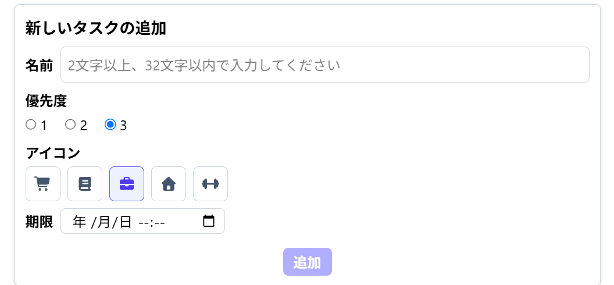
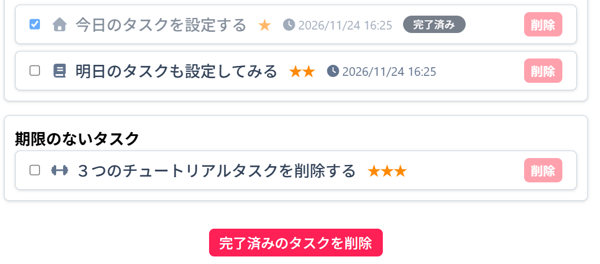
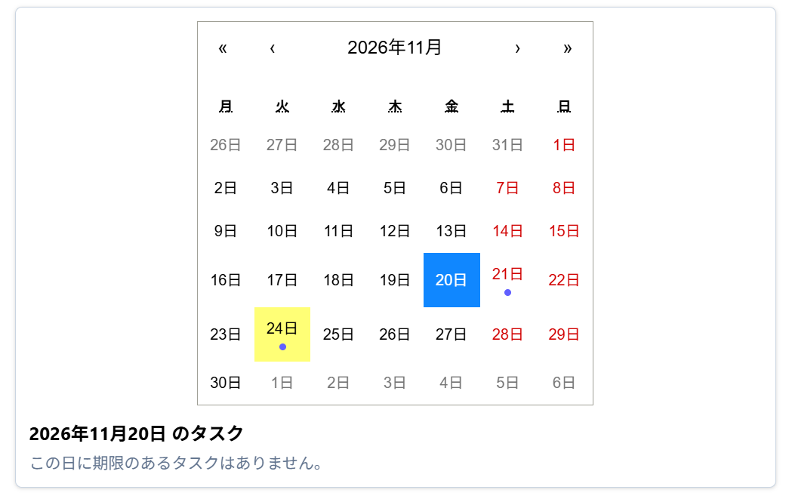
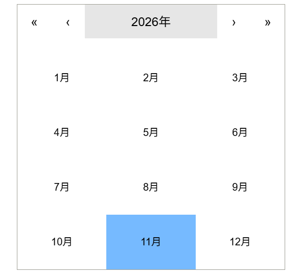
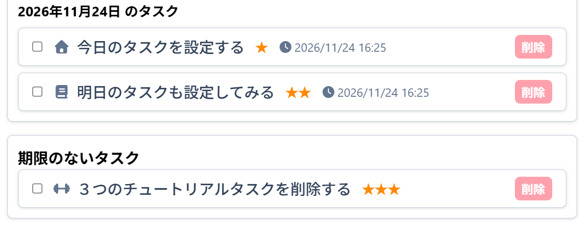

# CalendarTodo
URL：https://daito-s.github.io/CalendarTodo/

## 概要
React、TypeScript、Tailwind CSS を使用した、カレンダー付きのTodoアプリです。タスクに期限や優先度、アイコンを設定でき、データはブラウザのローカルストレージに保存されます。

## 操作方法
### タスクの追加
タスク名（前後の空白を除いて2〜32文字）を入力し、優先度・アイコン・必要に応じて期限を選んで「追加」を押します。 
期限を設定した場合カレンダーの領域に表示され、設定しなかった場合はカレンダーの領域の下に表示されます。 
日付が関係ないもの・いつでも表示しておきたいものは期限を設定せずに追加してみてください。

### タスクの操作
タスクのチェックボックスで完了状態を切り替え、「削除」で個別に削除できます。 
「完了済みのタスクを削除」を押すと完了したタスクをまとめて削除できます。

### カレンダーの操作
カレンダーの日付を選ぶと、その日に期限があるタスクを確認できます。選択している日時はカレンダーで青く表示され，今日は黄色く表示されます。
期限のあるタスクが登録された日は、カレンダーに印が表示されます。

「2026年11月」のように表示されている場所を押すと2026年の見たい月を選ぶことができます。さらに押すと年を選べます。
 
左右の矢印を押すと隣の月を，二重の矢印を押すと隣の年を見ることができます。

### チュートリアルタスク
始めてアクセスした際に、3つのチュートリアル用のタスクが登録されます。

### データの保存
タスクはブラウザに保存され、次回アクセス時にも引き継がれます。
保存のために特別な操作は必要ありません。

## 開発履歴
2026年10月16日　～　2026年11月24日